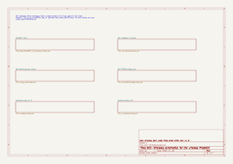
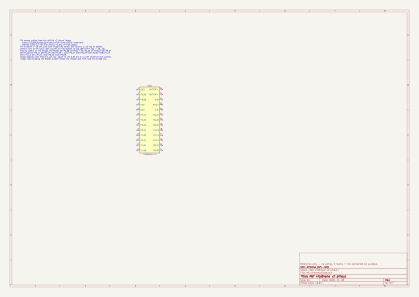
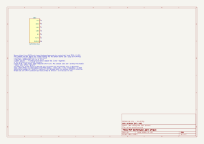
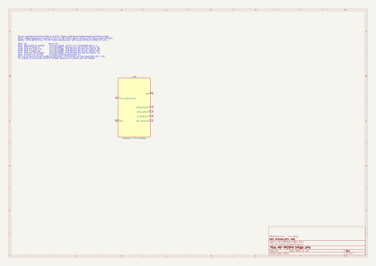
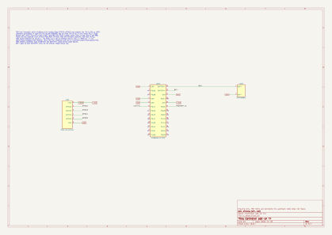
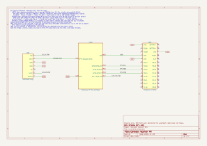

# Hardware schematics (KiCad 10)

Everything the wireless PhobGCC needs on one KiCad 10 project: `hardware/GCC-Wireless.kicad_pro`. The new sheets are drawings of what the upstream code and datasheets say; nothing here has been built or powered. Anything the sources do not say is drawn as a labelled `..._TBD` stub, not guessed.

Terms used once here: **TX** = transmitter (in the controller), **RX** = receiver (at the console), **SPI** = Serial Peripheral Interface (the 4-wire chip-to-chip link between the nRF52 and the RP2040), **UART** = serial port, **ERC** = electrical rules check (KiCad's wiring lint), **LiPo** = lithium-polymer battery, **PDF/SVG** = page and vector-picture formats, **GPIO** = general-purpose input/output pin, **nRF52** = Nordic radio chip on the nice!nano, **RP2040** = Raspberry Pi microcontroller (inside the Phob, and on the Pico in the RX).

## The sheets

Open the root sheet and double-click a box to enter a sheet (Esc or the up-arrow in the toolbar leaves it). Full set as one PDF: [img/schematics.pdf](img/schematics.pdf).

| # | Sheet | What it shows | Picture |
|---|---|---|---|
| 1 | Root | Six sub-sheets |  |
| 2 | PhobGCC 2.0.5 | Upstream Phob schematic, unmodified |  |
| 3 | Ref nice!nano v2 pinout | Pin names equal to the official image |  |
| 4 | Ref GameCube port pinout | Plug pins and wire colours |  |
| 5 | Ref RP2040 bridge pins | Pico pins the bridge firmware uses |  |
| 6 | Controller add-on TX | nice!nano + Phob J6 mirror + battery |  |
| 7 | Console receiver RX | nice!nano + Pico bridge + GameCube plug |  |

## How to use it in KiCad 10
1. Open `hardware/GCC-Wireless.kicad_pro`. Libraries come from `hardware/lib/` and `hardware/phob/` through project-relative tables, so there is nothing to install. (The GUI open was not checked here; see the Checks section.)
2. **Highlight a net:** use the highlight-net tool (right toolbar, shortcut the backtick key) and click a wire or pin. Everything on that net lights up, across sheets, because nets are joined by global labels (`GND`, `+3V3`, `SPI_SCK`, ...).
3. **Find J6 on the real board:** the Phob sheet's J6 is the 6-pad "GPIO Breakout". Pictures with J6 boxed: [back](img/phob2-bottom-annotated.png), [front](img/phob2-top-annotated.png). To jump from schematic to board, open `hardware/phob/PhobGCC_2_0_0_proto_1.kicad_pro`, then select a part in either editor; selection is cross-probed.
4. Do not save changes to `hardware/phob/` (see [phob/SOURCE.md](../hardware/phob/SOURCE.md)). Regenerate the new sheets: `uv run python -I build-support/gen-hardware.py`. Regenerate pictures and ERC: `bash build-support/export-schematics.sh`.

## Phob header J6 (the TX connection point)
Traced from the netlist of `hardware/phob/PhobGCC_2_0_0_proto_1.kicad_sch` (`kicad-cli sch export netlist`, 2026-11-05); matches the mirror symbol on the TX sheet.

| J6 pin | Net | Meaning |
|---|---|---|
| 1 | `+3V3` | Phob 3.3 V rail |
| 2 | `GPIO12` | Spare RP2040 GPIO; net has 2 nodes (J6 and a label) |
| 3 | `GPIO13` | same |
| 4 | `GPIO14` | same |
| 5 | `GPIO15` | same |
| 6 | `GND` | Ground |

## nice!nano v2 pins used (TX and RX)
Pin names equal the official pinout image (https://nicekeyboards.com/docs/nice-nano/pinout-schematic, listed in the symbol's datasheet field). Names are nRF52840 port.pin numbers: `P0.20` = port 0, pin 20.

| Use | nice!nano pin | Source line (quoted) |
|---|---|---|
| TX light/test input | P0.17 | `gcwireless/src/tx.cpp:7  pinMode(PIN_017, INPUT_PULLUP);` |
| TX power-down input | P0.31 | `gcwireless/src/tx.cpp:5  pinMode(PIN_031, INPUT_PULLUP);` |
| RX SPI SCK | P0.20 | `gcwireless/src/rx.cpp:74  PIN_020, // SCK` |
| RX SPI MOSI | P0.22 | `rx.cpp:75  PIN_022, // MOSI` |
| RX SPI MISO | P0.24 | `rx.cpp:76  PIN_024 // MISO` |
| Battery | BATTERY+ (two pads) | pinout image, no code |

The `PIN_0xx` to port-pin mapping comes from our own stand-in `build-support/gcwireless/pins.h`, not from upstream (upstream's board definition is missing). **Unverified** against a real nice!nano.

## RP2040 bridge and GameCube plug
| Signal | Pico pin | Source line (quoted) |
|---|---|---|
| SPI SCK in | GP18 | `gcwireless_bridge/src/main.cpp:88  gpio_set_function(PICO_DEFAULT_SPI_SCK_PIN, GPIO_FUNC_SPI);` (SDK default SPI0 pins: GP16 RX, GP17 CSn, GP18 SCK, GP19 TX, from Pico SDK 2.1.1 `pico.h`) |
| SPI data in (nRF MOSI) | GP16 | line 87, `PICO_DEFAULT_SPI_RX_PIN` |
| SPI data out (nRF MISO) | GP19 | line 89, `PICO_DEFAULT_SPI_TX_PIN` |
| SPI CSn | GP17 | line 90, `PICO_DEFAULT_SPI_CSN_PIN` |
| Joybus data | GP27 | `main.cpp:10  const int _pinTX  = 27;` |

GameCube plug (numbering from https://www.int03.co.uk/crema/hardware/gamecube/gc-control.html, read 2026-11-05; that page says its pinout is deduced from meter and oscilloscope work): 1 yellow 5 V; 2 red DATA; 3 green GND; 4 white GND; 5 not connected; 6 blue 3.43 V logic; 7 black shield. Cross-check against the Phob cable pads J1 (netlist): 1 `GCC_3.3V`, 2 `+5V`, 3 `GCC_DATA`, 4-6 GND. Same signals, different numbering.

## Free GPIOs on the Phob
Only GPIO12-15 are free (all 30 RP2040 GPIOs accounted for, BUILD_LOG 2026-10-09), and J6 breaks out exactly those four.

## Checks (2026-11-05)
- ERC (`kicad-cli sch erc --severity-all`, whole hierarchy; JSON in `img/sch/erc.json`): **0 errors on the new sheets and the root**. **6 errors, all inside the unmodified Phob sheet**, inherited from upstream and left alone because the Phob files must stay unmodified: `pin_not_connected` x2 (U13 pin 1, J8 pin 4), `power_pin_not_driven` x3 (#PWR06 +3V3, #PWR0109 VCC, U3 pin 4 VSS), `pin_not_driven` x1 (U8 pin 26 RUN).
- The GUI open of the project (R1) was not checked in a window here; only the command-line tool was run.
- Warnings, one line each:

| Where | Warning |
|---|---|
| TX | `multiple_net_names`: `+3.3V` and `+3V3` on the same items (deliberate bridge label, see Disagreements) |
| TX | `isolated_pin_label` GPIO12, GPIO13, GPIO14, GPIO15 (TBD: nice!nano side undecided) |
| TX | `isolated_pin_label` LIGHT_IN and POWEROFF_IN (one-ended by design) |
| RX | `isolated_pin_label` GC_5V_TBD, GC_3V3_TBD, SPI_CSN_TBD (TBD, code is silent) |
| Phob | `isolated_pin_label` RUN, SWCLK, SWD (upstream) |
| Phob | `multiple_net_names` +5V and VBUS (upstream) |
| Phob | `same_local_global_label` x2, +5V and GND (upstream) |
| Phob | `no_connect_dangling` x2 (upstream) |
| Phob | `pin_to_pin` x12 on stick-sensor symbols U2 and U5 (upstream, unspecified pin types) |
| Phob | `footprint_link_issues` x1: C1 footprint `CP_EIA-3528-12_Kemet-T...` not in KiCad's tantalum library |
| Phob | `endpoint_off_grid` x54 and `unconnected_wire_endpoint` x36 (upstream KiCad 6 file) |
| Phob | `lib_symbol_mismatch` x55 and `lib_symbol_issues` x18 (upstream's embedded symbols differ from the installed library) |

## Disagreements with upstream and with our earlier docs
- **TX has no Phob link upstream.** `tx.cpp @ 576878d` never reads the Phob; the TX sheet leaves the nice!nano side of GPIO12-15 as TBD and does not choose SPI or UART.
- **The plan said P0.13 / P0.04 appear only in v1.** The v2 pinout image carries a P0.13 cutoff legend, so that is wrong for v2.
- **`facts/joybus.md` has no GameCube plug pinout.** The pin numbers above come from int03, cited above.
- **Chip select mismatch.** The bridge slave expects CSn on GP17 but `rx.cpp` has the nRF CSN setup commented out (`PIN_002`, lines 66-71). Drawn as `SPI_CSN_TBD`.
- **KiCad 10 splits the Phob 3.3 V rail** into `+3.3V` and `+3V3` when the old file is a sub-sheet (standalone netlist: one net). The TX sheet adds a second global label to rejoin them.
- **Version naming.** Files are called `2_0_0_proto_1` but are commit ff645aa = tag v2.0.5.
- **Our `pins.h` is a stand-in**, not upstream's board definition.

## Still TBD (no source says)
Phob-to-nice!nano link wiring; which side powers J6 pin 1 (the Phob 3.3 V rail is normally fed by +5V -> AMS1117 -> D1; feeding it from the nice!nano is unverified, see [facts/power.md](facts/power.md)); battery connector; RX power source; nRF CSN pin.

Licences: new sheets GPL-3.0 like this repo; `hardware/phob/` CERN-OHL-S v2.
